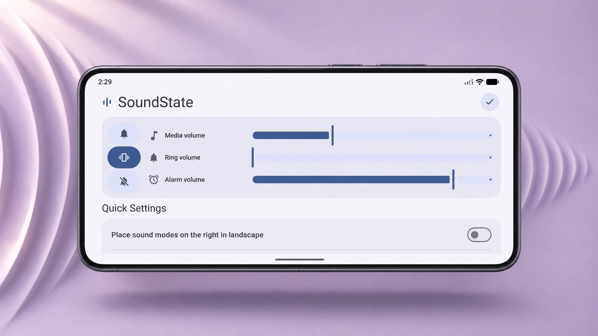
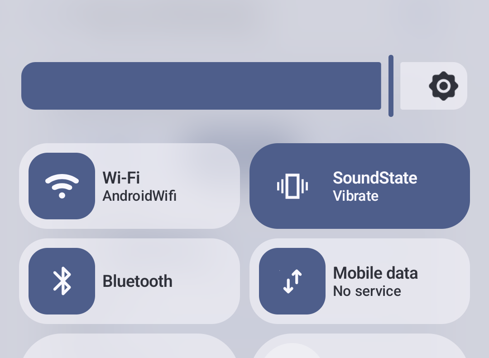
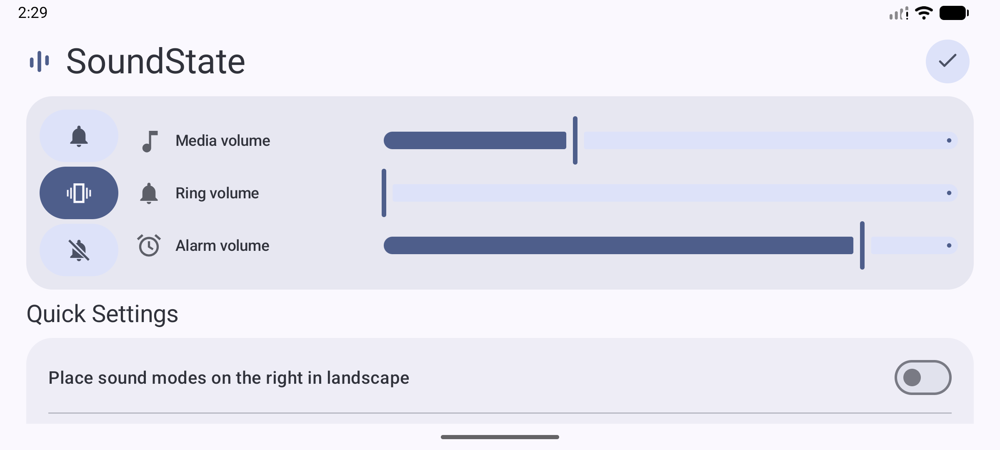

<p align="center"></p>
<h1 align="center">SoundState</h1>
<p align="center">Switch between ring, vibrate and silent from Android Quick Settings.</p>
<p align="center"><a href="README.md">简体中文</a> · <strong>English</strong></p>

If you’ve used a OnePlus phone with an alert slider, you may still reach for it on your way into a meeting. On a Pixel, that familiar motion becomes a press of the volume key followed by an on-screen choice. SoundState puts the switch in Quick Settings. Pull down to see your current mode and tap the tile to move to the next one.



[Download the APK from GitHub Releases](https://github.com/kaze-hk/SoundState/releases/latest) · Android 7.0 or later

## Switch modes right next to Wi-Fi



The tile shows your current mode with an icon and a label. If it reads **Ring** as you walk into a meeting, tap once to switch to **Vibrate**.

1. Install the APK and open SoundState. On Android 13 or later, tap **Add tile** and confirm the system prompt. On Android 12 or earlier, add SoundState from the Quick Settings editor.
2. Drag the tile near the top of the editor. The next time you pull down the shade, its icon shows your current ringer mode.
3. **Tap the tile** to cycle through **Ring → Vibrate → Silent → Ring**. **Touch and hold** to open the panel, go straight to a particular mode, or adjust media, ringtone and alarm volumes separately.



In landscape, you can move the mode buttons to the right side of the panel. SoundState follows the system light or dark theme and uses wallpaper colors on devices that support dynamic color.

**Silent mode and Do Not Disturb.** On some devices, entering or leaving silent mode also changes Do Not Disturb. If Android blocks the switch, open system settings from SoundState and grant Do Not Disturb access.

**Android 17 and later.** To keep switching modes from the tile after leaving the app, enable background tile controls on the home screen and allow the ongoing notification. You can stop the service from the app or the notification.

## Build locally

Open the project root in Android Studio, install Android SDK 37, and run the included Gradle Wrapper.

```sh
./gradlew :app:assembleDebug
./gradlew :app:testDebugUnitTest :app:lintDebug
```

The debug APK is written to `app/build/outputs/apk/debug/`.

Every push to `main` triggers a verified, signed GitHub release. [Release workflow](.github/workflows/android.yml)

## License

The original code and assets are available under the [PolyForm Noncommercial License 1.0.0](LICENSE) for noncommercial use, modification and distribution under its terms. Contact the rights holder for commercial licensing. Third-party components and the Gradle Wrapper retain their respective licenses.
