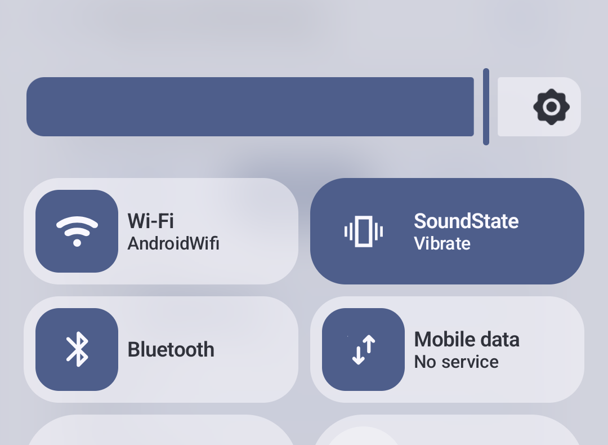

<p align="center"></p>
<h1 align="center">声态 · SoundState</h1>
<p align="center">下拉快捷设置，切换响铃、振动与静音。</p>
<p align="center"><strong>简体中文</strong> · <a href="README.en.md">English</a></p>

用过带三段式拨杆的一加手机，大概会记得走进会议室前，拇指轻轻一拨就能让手机安静下来。换到 Pixel，这个小动作变成了先按音量键，再到屏幕上选模式。声态把开关放进快捷设置，下拉时就能看见当前模式，点一下就切到下一档。


[从 GitHub Releases 下载 APK](https://github.com/kaze-hk/SoundState/releases/latest) · Android 7.0 及以上

## 下拉，在 Wi-Fi 旁边切换模式



声态磁贴上的图标和文字显示当前模式。比如开会前看到「响铃」，轻点一次就会变成「振动」。

1. 安装 APK 并打开声态。Android 13 及以上点 **添加快捷按钮**，在系统弹窗中确认。Android 12 及更早版本请打开快捷设置的编辑界面，手动添加声态。
2. 在快捷设置的编辑界面，把声态拖到靠前的位置。下次下拉，磁贴图标就会告诉你手机当前处于哪一档。
3. **轻点磁贴**，按 **响铃 → 振动 → 静音 → 响铃** 循环切换。**长按磁贴**可打开面板，直接选中想要的模式，或分别调节媒体、铃声和闹钟音量。


横屏时，可以在面板设置里把模式按钮移到右侧。界面跟随系统深浅主题，并在支持动态配色的设备上使用壁纸色。

**静音与勿扰。** 部分设备在进入或退出静音时会同时改变勿扰状态。如果系统阻止切换，可从声态首页进入设置，授予勿扰模式使用权。

**Android 17 及以上。** 如需离开应用后继续通过磁贴切换模式，可在首页开启后台磁贴控制并允许持续通知。可随时从首页或通知中停止。

## 本地构建

用 Android Studio 打开项目根目录，安装 Android SDK 37，然后运行项目自带的 Gradle Wrapper。

```sh
./gradlew :app:assembleDebug
./gradlew :app:testDebugUnitTest :app:lintDebug
```

调试 APK 位于 `app/build/outputs/apk/debug/`。

## 许可

原创代码和资源采用 [PolyForm Noncommercial License 1.0.0](LICENSE)，允许按条款进行非商业使用、修改和分发。商业授权请与权利人另行约定。第三方组件及 Gradle Wrapper 遵循各自许可。
